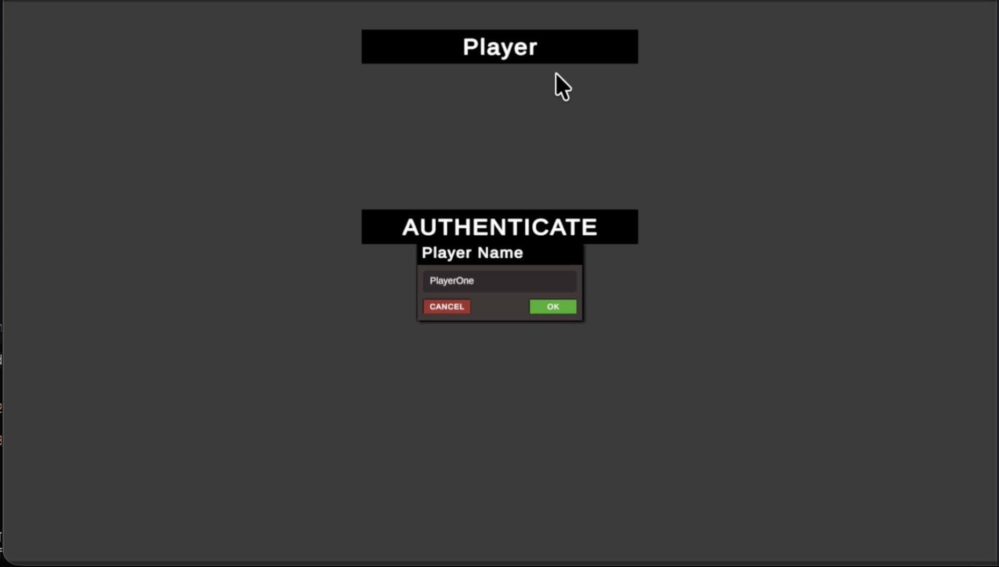
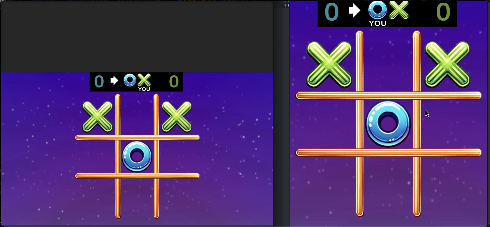
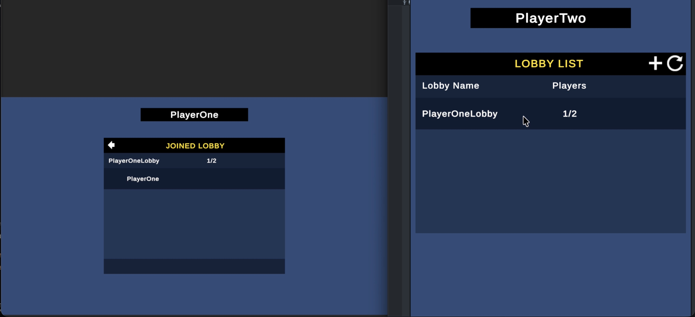
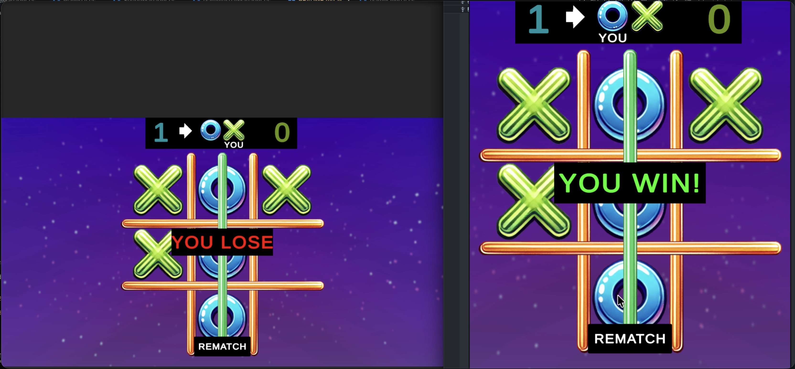

# Tic-Tac-Toe Multiplayer

A real-time online multiplayer Tic-Tac-Toe game built with **Unity 6** and **Netcode for GameObjects**, using **Unity Gaming Services (UGS)** — Authentication, Lobbies, and Relay — so two players can find each other in a lobby and play together over the internet without any port forwarding or dedicated servers.

## Features

### Gameplay
- Classic 3x3 Tic-Tac-Toe: **Cross vs Circle**, server-authoritative turn order
- Win detection with animated win-line highlighting (horizontal, vertical, and both diagonals)
- Tie detection when the board fills up
- **Running score counter** across rematches (Cross score / Circle score)
- **Rematch button** — board resets, scores carry over
- Turn indicator (arrow pointing at the active player, "YOU" labels)
- Sound effects and background music (Unity Audio)

### Netcode & Services
- **Unity Lobby service** — create public/private lobbies, browse and join existing lobbies by clicking them, Quick Join, kick players (host only), heartbeats and rate-limit-friendly polling
- **Unity Relay service** — both players connect through a Relay allocation (DTLS), so the game works behind NAT/firewalls with no port forwarding
- **Anonymous Authentication** — players sign in with a display name; each name maps to its own UGS profile
- The Relay join code is passed through lobby data, so clients automatically discover how to connect
- **Auto-start**: the game launches as soon as the lobby has 2 players
- **Disconnect handling** — if the opponent leaves mid-game, the lobby is cleaned up and both players are returned to the lobby scene
- Local-only fallback removed: the lobby flow is the single path into a game

## Tech Stack

| Technology | Used for |
|---|---|
| Unity 6000.3 (URP) | Engine & 2D rendering |
| Netcode for GameObjects (NGO 2.x) | Client/server networking, RPCs, NetworkVariables |
| Unity Lobby (UGS) | Matchmaking / lobby management |
| Unity Relay (UGS) | NAT-friendly multiplayer transport |
| Unity Authentication (UGS) | Anonymous sign-in |
| Input System | Player & UI input |
| Multiplayer Play Mode | Local multiplayer testing with multiple Editor instances |
| TextMeshPro | UI text |

## How It Works

```
┌──────────────┐   1. Authenticate    ┌───────────────────┐
│   Player A   │ ───────────────────► │ Unity Authentication│
└──────┬───────┘                      └───────────────────┘
       │ 2. Create Lobby / Join / Quick Join
       ▼
┌──────────────────┐   3. Lobby full (2 players) → allocate Relay
│  Unity Lobby API  │ ─────────────────────────────────────────────┐
└──────┬───────────┘                                             │
       │ 4. Relay join code written to lobby data                 │
       ▼                                                         ▼
┌──────────────┐   5. Client reads join code   ┌─────────────────────┐
│   Player B   │ ────────────────────────────► │   Unity Relay (DTLS) │
└──────┬───────┘                               └─────────────────────┘
       │            6. Host + Client connect through Relay, both load GameScene
       └────────────────────────────────────────► 🎮 Game starts
```

1. Both players enter a name and **Authenticate** (anonymous sign-in via UGS)
2. One player **creates a lobby** (or uses **Quick Join**); the other joins from the lobby list
3. When the lobby reaches 2 players, the host **allocates a Relay server** and writes the **join code into the lobby's data**
4. The client polls the lobby, reads the join code, and joins the same Relay allocation
5. Both players load `GameScene`; the host is `Cross`, the client is `Circle`, and the game begins automatically

## Getting Started

### Prerequisites
- Unity 6000.3.8f1 (or any Unity 6.3+ with the packages listed below)
- A free [Unity account](https://id.unity.com/)

### Setup
1. Open the project in Unity Hub
2. **Link the project to Unity Gaming Services:**
   - Go to `Edit > Project Settings > Services`
   - Sign in and link the project to a Unity Dashboard project (or create a new one)
3. **Enable the services** in the [Unity Dashboard](https://dashboard.unity3d.com/):
   - **Authentication** (Anonymous sign-in enabled)
   - **Lobby**
   - **Relay**
4. Open the `LobbyScene` and press **Play** — or use **Multiplayer Play Mode** (`Window > Multiplayer Play Mode`) to test with 2 virtual players locally

### Testing multiplayer locally
- Use **Multiplayer Play Mode** to run multiple Editor instances on one machine — each virtual player authenticates under its own profile name
- Or build a standalone player (`File > Build Settings` — `LobbyScene` is scene 0, `GameScene` is scene 1) and run one build + one Editor instance

## Project Folder Structure

```
Tic-Tac-Toe-Multiplayer/
├── Assets/
│   ├── InputActions.cs / .inputactions   # Input System action definitions
│   ├── Prefab/                           # Prefabs (networked objects, UI)
│   ├── Resources/                        # Unity Player Account settings
│   ├── Scenes/
│   │   ├── LobbyScene.unity              # Entry scene: auth + lobby UI
│   │   └── GameScene.unity               # The actual tic-tac-toe game
│   ├── Scripts/                          # Core gameplay scripts
│   │   ├── GameManager.cs                # Board state, turns, win/tie, scores, RPCs
│   │   ├── GameOverUI.cs                 # Win/lose/tie banner + rematch button
│   │   ├── PlayerUI.cs                   # Turn indicator + score display
│   │   ├── GridPosition.cs               # Clickable grid cell (sprite + collider)
│   │   ├── GameVisualManager.cs          # Marks, win line, board visuals
│   │   └── SoundManager.cs               # SFX + music
│   ├── Lobby/                    # Lobby & Relay integration (UGS)
│   │   ├── Scripts/
│   │   │   ├── LobbyManager.cs           # Auth, lobby CRUD, polling, relay join code, scene flow
│   │   │   ├── StartGameManager.cs       # Relay allocation/join, disconnect handling
│   │   │   ├── AuthenticateUI.cs         # Sign-in button
│   │   │   ├── EditPlayerName.cs         # Player name entry
│   │   │   ├── LobbyUI.cs                # Joined-lobby panel (players, leave, kick)
│   │   │   ├── LobbyListUI.cs            # Browsable lobby list
│   │   │   ├── LobbyListSingleUI.cs      # Single lobby row (click to join)
│   │   │   ├── LobbyCreateUI.cs          # Create lobby panel (name, private, max players)
│   │   │   ├── LobbyPlayerSingleUI.cs    # Single player row in the lobby panel
│   │   │   └── InputWindow/              # Reusable text/number input popup
│   │   └── Textures/                     # Lobby UI textures
│   ├── Settings/                         # URP + Multiplayer Play Mode settings
│   ├── Sounds/                           # Audio clips
│   └── Textures/                         # Game art (X, O, board, background...)
├── Packages/                             # UPM manifest & package lock
├── ProjectSettings/                      # Unity project settings (build scenes, services)
└── README.md
```

## Key Scripts Explained

| Script | Responsibility |
|---|---|
| `GameManager.cs` | NetworkBehaviour holding all game state: the 3x3 board, whose turn it is (`NetworkVariable`), win/tie detection, scores. Exposes RPCs like `ClickedOnGridPositionRpc` and `RematchRpc`. Server-authoritative. |
| `LobbyManager.cs` | Singleton that owns the UGS integration: anonymous auth, create/join/quick-join/kick/leave, heartbeat (host, every 15s), polling (every 1.1s), auto-start at 2 players, and passing the Relay join code through lobby data. Persists across scenes. |
| `StartGameManager.cs` | Allocates the Relay allocation on the host, joins it on the client, wires `UnityTransport.SetRelayServerData`, and handles disconnects (returns both players to `LobbyScene`). Persists across scenes. |
| `GridPosition.cs` | One clickable cell — forwards clicks to `GameManager` with its grid coordinates. |
| `GameOverUI.cs` / `PlayerUI.cs` | End-of-round banner + rematch button; turn arrows and score texts. |

## Screenshots

| | |
|---|---|
|  |  |
| *LobbyScene — authenticate & find a lobby* | *GameScene — a match in progress* |

| | |
|---|---|
|  |  |
| *The lobby list & create-lobby panel* | *Win/lose/tie banner with rematch* |

## Roadmap

- [ ] Private lobby join by code (share lobby code with a friend)
- [ ] In-game "return to lobby" button after a game
- [ ] Player names shown in-game (Cross/Circle labels)
- [ ] Move history / undo tracking
- [ ] Mobile build support

## Credits

- Lobby & Relay integration based on the open lobby/relay flow popularized by CodeMonkey's Unity Lobby tutorial, adapted for this project (game-specific features stripped, disconnect handling and scene flow rewritten for Tic-Tac-Toe)
- Built with [Netcode for GameObjects](https://github.com/Unity-Technologies/com.unity.netcode.gameobjects) and [Unity Gaming Services](https://unity.com/products/gaming-services)
